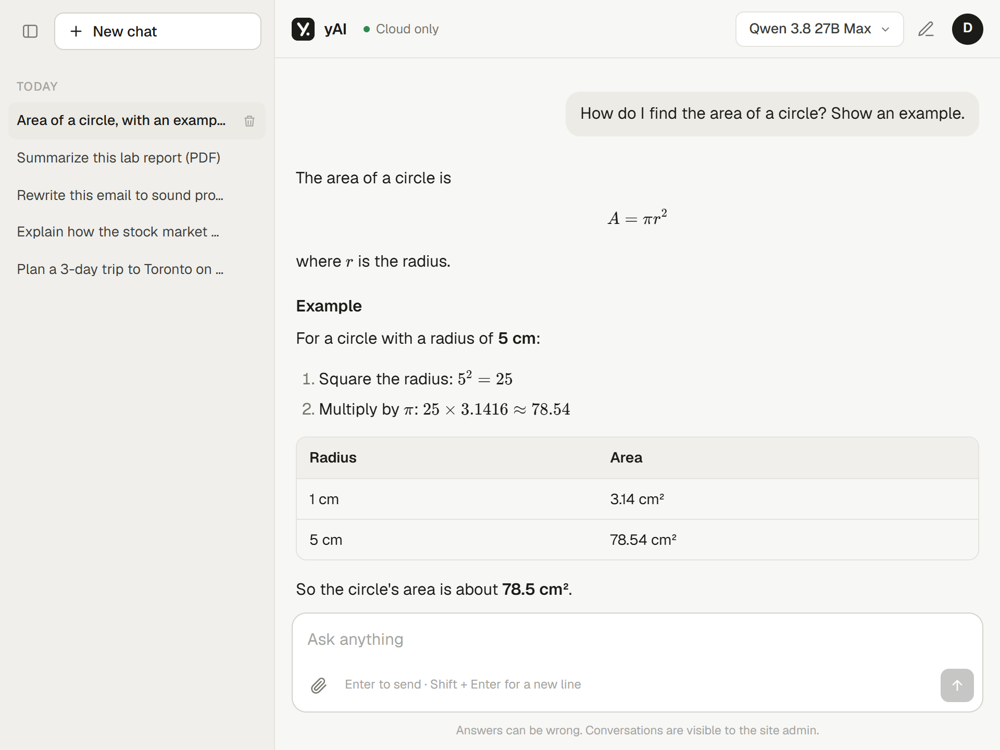

# yAI

A ChatGPT-style web app that runs AI models on my own hardware: small models on my laptop's GPU, and a
27B model, an image generator and a video generator on serverless cloud GPUs that only run while someone is using them.



| Model | Where it runs | Speed |
|---|---|---|
| **Qwen 3.8 27B** (FP8, reads images) | Modal serverless vLLM, 48 GB L40S | ~34 tokens/s |
| **yAI 3 Coder** (Qwen3 Coder 30B; yAI Code only, 64k context) | Modal serverless vLLM, 48 GB L40S | not measured yet (only 3B of its 30B parameters work on each token) |
| yAI Q3.5 (Qwen 3.5 4B Uncensored) and yAI P4 (Phi 4 Mini) | LM Studio on a 6 GB laptop GPU | up to ~200 tokens/s |
| **Qwen-Image 2.1** (create and edit images) | RunPod serverless ComfyUI, 48 GB GPU | seconds per image |
| **MiniMax H3** (videos with sound, from text or a photo) | RunPod serverless ComfyUI, 48 GB GPU | about 3 minutes per 5-second clip |

## Features

- **Streaming chat** with Markdown, tables, code blocks and LaTeX math (KaTeX)
- **Hybrid routing**: local models when the PC is on; the cloud model is always available and becomes the
  default automatically when the PC is offline
- **Make Image / Make Video**: text → image, photo editing (image → image), text → video and photo → video,
  with per-user daily limits; only sexual content involving minors or real people is blocked
- **Accounts** with saved chat history and images. yAI is invite-only: everything (chat, cloud models, images, video) needs an account, and people request an access code from the sign-in page to create one
- **Image and PDF input**: images are downscaled in the browser; PDF text is extracted with pdf.js, and
  scanned PDFs fall back to rendering their pages as images
- **Search the web**: the Search button looks the question up, reads the top pages and answers with numbered
  sources ([1], [2]) that link to them
- **Projects**: files (PDFs, notes, code) and instructions kept together; every chat started in a project gets them
- **Live previews**: HTML, SVG and JavaScript in an answer run in a sandboxed panel (the answer's CSS and JS blocks included)
- **Model arena** (`/arena`): one question, two anonymous models side by side, a vote, an Elo leaderboard, and the
  coding benchmark results from yAI Code's `/bench`
- **Usage page** (`/usage`): your messages, images, videos, web searches and yAI Ultra spend against the daily
  limits, the last 30 days and all time; admins also see everyone
- **Live status**: LM Studio's real model-load progress, and a timer while a cloud GPU wakes up
- **Token stats** on every answer (tokens, tokens/s, time) and an **admin dashboard** for activity
- No framework and no npm dependencies: plain HTML, CSS and JavaScript, Node.js serverless functions

## How it works

```
                         ┌─▶ RunPod serverless: Qwen 3.8 27B (vLLM)       scales to zero when idle
Browser ─▶ Vercel ───────┼─▶ RunPod serverless: Qwen-Image 2.1, MiniMax H3 (ComfyUI)
   (UI + /api functions) ├─▶ Upstash Redis: accounts, chats, images, videos, activity log
                         └─▶ Cloudflare Tunnel ─▶ bridge.js on the PC ─▶ LM Studio (local models)
```

- **`api/`** holds the Vercel functions. They check access, route each request to the right model, and
  re-emit model output as simple Server-Sent Events, so the browser never talks to a model server directly.
- **Image and video jobs are polled.** `/api/image` starts a RunPod job and gives the browser a signed token
  for it. The browser polls until the result is ready, so a slow video never hits a function time limit.
  Workflows live in `workflows/` (ComfyUI "Export (API)" format, with `$prompt` and `$image` placeholders).
- **Cloud GPUs scale to zero.** A conversation costs about $0.05 and an image well under a cent. After a quiet
  period the first request wakes a GPU (up to a minute or two), and the UI shows a timer while it does.
- **`bridge.js`** runs on the PC. It only listens on localhost, requires a shared bearer token, and only allows
  the chat, model-list and warm-up routes. It also runs one shared warm-up per model, so several users picking
  the same model load it once.
- **Thinking is forced off** (`reasoning_effort: "none"` / `enable_thinking: false`), and any reasoning a model
  produces anyway is stripped before it reaches the user.

### yAI Code (terminal agent)

A Claude Code–style agent for the terminal that uses the same models as the site, plus **yAI 3 Coder** (Qwen3 Coder 30B), which only yAI Code can use and is its default. yAI Code offers yAI 3 Coder, yAI Ultra, Qwen 3.8 27B Max, yAI Q3.5 and yAI P4. It signs in with your yAI account, works on the files in the folder you start it from, and asks before it edits a file or runs a command.

```powershell
cd path\to\yAI
npm link            # once: makes the `yai` command available everywhere
cd path\to\any\project
yai
```

- `/model` switch model · `/mode` or **shift+tab** cycle ask / accept edits / plan (read-only) · `/clear` · `/compact` · `/init` (writes YAI.md) · `/status` · `/login` · `/logout`
- `/fix [cmd]` runs the tests and lets yAI fix them until they pass (`/fix watch` reruns them on every save) · `/review` has a second model review your uncommitted changes · `/commit` writes the message and commits
- `/look [url|file]` screenshots the page (desktop and phone) for a design review by the vision model · `@mockup.png build this` describes an image so the coder can build it · `/showcase` records a demo video of the page (Chrome + ffmpeg)
- `/duo`: Qwen 3.8 27B plans each request and reviews the change, yAI 3 Coder writes it · `/tutor`: hints and explanations instead of finished solutions · `/share` publishes the session at an unlisted link (`/share?id=…` on the site)
- `/theme` picks a look (yAI Dark, the default, and yAI Light from the redesign; Midnight, Classic Blue, Paper, Amber) · `/undo` reverts yAI's last edit · `/resume` continues the last conversation · `/plan` read-only planning
- `/bench [model]` runs the coding benchmark (6 tasks, 44 tests, a fresh session and 5 minutes per task) and adds the score to the arena leaderboard
- **Web**: yAI can `web_search` and `web_fetch` pages (including your own dev server on localhost)
- **Background tasks**: dev servers and watchers run in the background (`task_output`, `task_stop`); `/tasks` lists them, and they stop when yAI exits
- **MCP**: `/mcp add <name> <command>` (or a URL) adds a server; project servers in `.mcp.json` (Claude Code's format) start after you OK them; tools that aren't marked read-only ask first
- `/image [16:9] [@photo.jpg] prompt` and `/video [16:9] prompt` make images and videos into `yai-media/`
- The first run in a folder asks whether to trust it; the footer above the prompt shows the git branch, modified files, context used and the approval mode.
- `@file` attaches a file (Tab completes) · `!command` runs a command yourself · **Esc** stops yAI
- `yai -c` continues the last conversation in a folder · `yai -p "question"` answers once (read-only)
- Paths are locked to the folder you started in. Sign-in is stored in `~/.yai/config.json` (30-day session).
- The server only accepts the agent's system prompt from signed-in users (`agent: true` in `/api/chat`).

## Security

- Passwords are hashed with **scrypt**; sessions are **HMAC-signed, HttpOnly** cookies, with separate keys for
  user and admin sessions so one can't be replayed as the other.
- All model and user text is HTML-escaped before Markdown formatting, so it can't inject markup.
- Image and video prompts are not censored, except anything sexual involving minors and sexual images of real people (a named person or an uploaded photo). They are rate-limited per day.

## Running it

Requirements: Node.js 18+. For local models: [LM Studio](https://lmstudio.ai) and
[cloudflared](https://developers.cloudflare.com/cloudflare-one/connections/connect-networks/downloads/).
For cloud models: a [RunPod](https://www.runpod.io) account with serverless endpoints, and an Upstash Redis
database (added to the Vercel project from the Vercel Marketplace).

1. Create a `.env` with a long random `BRIDGE_TOKEN`:
   ```
   node -e "console.log('BRIDGE_TOKEN=' + require('crypto').randomBytes(32).toString('hex'))" > .env
   ```
2. Start LM Studio's server, then `npm run bridge` and `npm run tunnel`.
3. Deploy to Vercel and set the environment variables below, using the tunnel URL plus `/v1` as `LMSTUDIO_URL`.

On Windows, `Start yAI.cmd` does steps 2–3 in one go (it points Vercel at the new tunnel URL and redeploys),
and `Stop yAI.cmd` unloads every model and stops everything, freeing the GPU.

For local development without Vercel: `npm start`, then open http://127.0.0.1:3000.

| Variable | Purpose |
|---|---|
| `LMSTUDIO_URL`, `BRIDGE_TOKEN` | Tunnel URL + `/v1`, and the shared secret for the bridge |
| `RUNPOD_API_KEY` | RunPod API key for the cloud endpoints |
| `RUNPOD_ENDPOINT_ID` | Serverless vLLM endpoint serving Qwen 3.8 27B as `qwen3.8-27b-cloud` |
| `RUNPOD_CODER_ENDPOINT_ID` | Serverless vLLM endpoint serving Qwen3 Coder 30B (shown as yAI 3 Coder) as `qwen3-coder` (yAI Code only; the website lists it greyed out) |
| `RUNPOD_CODER_CONTEXT` | Optional: the coder endpoint's `MAX_MODEL_LEN` if it isn't 32768, so yAI Code sizes conversations to it |
| `MODAL_API_KEY` | The key the Modal chat servers check (the `VLLM_API_KEY` in the `yai-vllm` Modal secret) |
| `MODAL_CODER_URL` | Modal URL of the coder server (`modal deploy modal/llm.py` prints it); when set, yAI 3 Coder runs on Modal instead of RunPod |
| `MODAL_MAX_URL` | Modal URL of the Qwen 3.8 27B server; when set, it runs on Modal instead of RunPod |
| `MODAL_ULTRA_URL` | Modal shared endpoint for yAI Ultra (Kimi K3, billed per token, no cold start) |
| `MODAL_ULTRA_KEY` | Its proxy token, as `wk-….ws-…` (sent as a Bearer token) |
| `ULTRA_DAILY_USD` | Optional: how much yAI Ultra each person can use per day (default 2) |
| `ULTRA_STREAM` | Optional: `0` asks yAI Ultra for whole replies instead of streaming them |
| `BRAVE_API_KEY` / `TAVILY_API_KEY` | Optional: a search API for "Search the web" and yAI Code's web_search (without one, DuckDuckGo's HTML page is used) |
| `RUNPOD_IMAGE_ENDPOINT_ID` | ComfyUI endpoint for text → image (`workflows/t2i.json`) |
| `RUNPOD_EDIT_ENDPOINT_ID` | ComfyUI endpoint for photo editing (`workflows/edit.json`) |
| `RUNPOD_VIDEO_ENDPOINT_ID` | ComfyUI endpoint for text or photo → video (`workflows/video.json`) |
| `KV_REST_API_URL`, `KV_REST_API_TOKEN` | Upstash Redis (set automatically by the Vercel integration) |
| `ACCESS_CODE` | Invite code needed to create an account |
| `SESSION_SECRET` | Signs user and admin sessions |
| `ADMIN_ACCOUNTS` | Comma-separated usernames with admin access |
| `ADMIN_USERNAME`, `ADMIN_PASSWORD` | Optional separate admin login for `/admin` |
| `SYSTEM_PROMPT`, `MODEL` | Optional: assistant instructions and default model |

Without the Upstash variables, accounts, chats and the activity log are stored on the PC by `bridge.js`.
The model menu is an allowlist in `lib/handlers.js` (`MODELS`).
